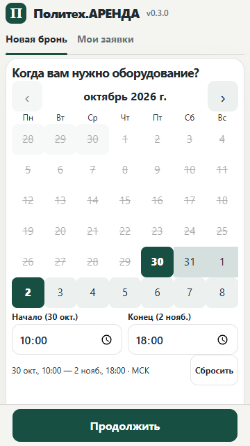
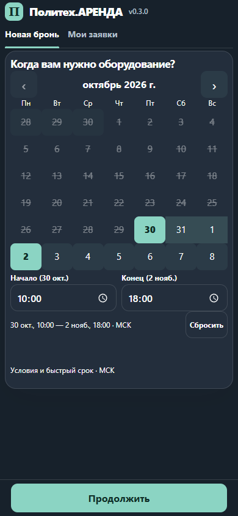

# PolyRental v0.3.0 — 26 октября 2026

## 1. Резюме

Mini App открывает календарь диапазона на первом экране; сотрудник по подтверждённому Telegram ID попадает в управление. Бот, Mini App API и web используют общий модуль ролей и строгий env. Загруженные документы получают локальную предварительную классификацию и зашифрованный вердикт для ручного PII-ревью. Фото каталога масштабируются в стабильной области 4:3.

Сохранены поля запросов `start`, `end`, `request_id`, идемпотентность, количество/доступность с буфером, статусы, команды `/add`, `/set`, старый приём sendData, согласия, шифрование и ручное решение по документам. Базовый checkout — `040adc6` (VERSION `0.2.8`, README `0.2.7`).

Предлагаемое описание PR: «Раньше календарь открывался отдельно для каждой даты, а правила ролей расходились между компонентами. Теперь период выбирается двумя тапами на первом экране, серверная роль едина, а PII-администратор получает локальный предварительный вердикт по фото перед ручным решением».

## 2. Изменённые файлы

| Слой | Файлы |
|---|---|
| Роли и точки входа | `app/roles.py` (новый), `app/bot.py`, `app/miniapp.py`, `app/miniapp_server.py`, `app/web.py` |
| Mini App | `app/miniapp_static/range-calendar.js` (новый), `app/miniapp_static/app.js`, `app/miniapp_static/index.html`, `app/miniapp_static/style.css` |
| Документы и БД | `app/document_check.py` (новый), `app/pii.py`, `app/db.py`, `alembic/versions/20261026_07_document_checks.py` (новая) |
| Конфигурация, сборка и CI | `.env.example`, `Dockerfile`, `compose.yaml`, `.github/workflows/ci-cd.yml`, `scripts/deploy.ps1`, `tools/browser-qa/package.json`, `tools/browser-qa/package-lock.json` |
| Тесты | `tests/test_v030.py`, `tests/calendar.test.cjs`, `tests/calendar-ui.cjs` (новые), `tests/conftest.py`, `tests/test_release.py`, `tests/test_telegram_environment.py` |
| Версия и документация | `VERSION`, `README.md`, `CHANGELOG.md`, `docs/adr/0001-v0.3.0.md`, `docs/releases/v0.3.0.md`, `docs/testing-strategy.md`, `docs/privacy-policy-draft.md` |
| Визуальные подтверждения | `docs/qa/v0.3.0-calendar-360-light.png`, `docs/qa/v0.3.0-calendar-390-dark.png` |
| Дополнительная приёмка | `.gitignore`, `.dockerignore`, `scripts/benchmark_documents.py`, `tests/test_document_benchmark.py`, `docs/qa/v0.3.0-acceptance.md`, `docs/qa/v0.3.0-document-benchmark.json`, `docs/qa/v0.3.0-document-benchmark-baseline.json` |

Локальная `.idea/` не относится к обновлению и не включается в коммиты. Рабочая `.env` не менялась.

## 3. Запуск и проверка

1. Сохраните прежние образы или их digest и сделайте обычную зашифрованную резервную копию. Проверьте `ADMIN_IDS`: непустой список положительных Telegram ID через запятую. `PII_ADMIN_IDS` задаёт отдельный PII-доступ; может быть пустым. Сохраните существующий `PII_MASTER_KEY`.
2. Новый необязательный env: `DOCUMENT_CHECK_MODE=local` (дефолт) либо `manual`. Рекомендуемая новая версия текста согласия: `PRIVACY_POLICY_VERSION=2026-10-26-v3`. Изменённый текст проверяется также по хешу: открытую до обновления форму потребуется открыть заново.
3. Сначала соберите образы **с новыми исходниками**, затем примените миграции, затем перезапустите сервисы. Для текущей публичной конфигурации PowerShell:

```powershell
$releaseCompose = @('compose', '-f', 'compose.yaml', '-f', 'compose.miniapp.yaml', '-f', 'compose.public.yaml')
docker @releaseCompose build bot miniapp
docker @releaseCompose run --rm miniapp alembic upgrade head
docker @releaseCompose up -d bot miniapp nginx
```

Это инструкция для согласованного развёртывания; в ходе подготовки релиза production не перезапускался. Deploy-скрипт теперь соблюдает тот же порядок сборки и миграции. В локальной конфигурации с web вместо miniapp соберите web и выполните миграцию из него.

4. `/health` и метка Mini App должны показывать `0.3.0`. В Telegram выполните `/start` для обновления старой reply-клавиатуры. Проверьте клиента, обычного администратора и отдельного PII-администратора. Открытие кнопкой и прямой ссылкой должно приводить сотрудника в управление; «Как клиент» возвращает календарь без изменения прав.
5. Клиент создаёт заявку и видит её в боте и Mini App; другой клиент её не видит. Сотрудники видят общий список. Повторная отправка того же `request_id` возвращает прежний ID.
6. После подтверждения загрузите синтетические изображения: однотонный кадр, другой документ, студенческий. Только PII-администратор открывает вердикты, причину, фотографии и ручное подтверждение/исправление. Проверка не удаляет фото и не отклоняет анкету автоматически.

Автоматические проверки:

```sh
docker compose --profile test run --rm --build test
node --test tests/calendar.test.cjs
npm ci --prefix tools/browser-qa
tools/browser-qa/node_modules/.bin/playwright install --with-deps chromium
NODE_PATH=./tools/browser-qa/node_modules node tests/calendar-ui.cjs
```

PowerShell-вариант и подробности — в [стратегии тестирования](../testing-strategy.md).

## 4. Принятые дефолты

- Сохранено ограничение текущего приложения: выдача с «сегодня по МСК + 4 дня». Прошлые дни disabled. Оба времени сериализуются с `+03:00`.
- Буфер (обычно 24 ч) разделяет аренды; минимальный срок аренды не вводится. Сервер учитывает индивидуальный буфер артикула в доступности и создании.
- Нестандартные фото обрезаются через `object-fit: cover` в 4:3; операторская миниатюра — 76×57 px.
- «Не документ», «другой документ», неопределённость и сбой ведут на ручное ревью; автоудаления и автоматического отказа нет. При ненастроенном локальном OCR загрузка продолжает работать.
- Полные ПД и результаты проверки видны только `PII_ADMIN_IDS`; обычный оператор видит статус анкеты. Согласованность списков не расширяет PII-доступ.
- Обновление «Моих заявок» — при открытии/обновлении; websocket не требуется. Отдельная новая роль операторов не вводится. «Как клиент» реализовано.

Полное обоснование и точные ограничения: [ADR](../adr/0001-v0.3.0.md).

## 5. Проверки и результаты

- **123 pytest-теста прошли** в Docker с PostgreSQL `polyrental_test`: и на обновлённой тестовой БД, и на новой пустой БД отдельного временного Compose-проекта `polyrental-v030-ci` со всей цепочкой миграций. Включены существующие регрессии бронирования/буфера/статусов/PII и новые проверки ролей, запуска, изоляции, синхронизации, OCR, таймаута и миграции. Один DeprecationWarning приходит из Starlette/AnyIO.
- **3 unit-теста Node прошли**: два тапа и повторный выбор, same-day период и неверное время, дата/МСК, переход месяца/года/високосного дня.
- **10 браузерных сценариев прошли**: 320×640, 360×640, 390×844, 430×844 в светлой и тёмной темах; серверная роль/клиентский режим; PII-ревью с ручным подтверждением и исправлением. Календарь, время и кнопка доступны без прокрутки; переполнения по горизонтали нет; дни не меньше 44×44 px. Измеренный рендер около 1–2 мс на локальном Chrome, лимит теста 100 мс. Высота календаря не меняется при переключении месяца; резервируется ещё до исполнения JS. Проверка фото разных размеров даёт стабильные 76×57 px.
- Без дополнительных запросов при навигации календаря; никакие фото из QA не отправлялись в Telegram или внешние сервисы. Синтетический OCR действительно запущен локально в контейнере, остальные отрицательные/аварийные ветки дополнены моками.
- `compileall`, `node --check`, `git diff --check` и PowerShell parser для deploy-скрипта проходят.
- Первый удалённый CI для [PR №1](https://github.com/Opragopa/PolyRental/pull/1) прошёл: [run 40390942992](https://github.com/Opragopa/PolyRental/actions/runs/40390942992), Test и Calendar and mobile UI — success, production deploy — skipped. Дополнительная приёмка расширяет CI на Chromium/WebKit и benchmark; актуальный результат последнего head проверяется отдельно.
- Дополнительные проверки локально: 22 браузерных сценария Chromium/WebKit с mobile/touch, нативной MainButton и themeChanged. Benchmark на 72 синтетических изображениях: после выравнивания наклона student recall 24/24, false_non_document 0/48, false_student 0/48, строгая document accuracy 75%, p95 одного изображения 0.1601 с. Подробности и знаменатели — в [отчёте приёмки](../qa/v0.3.0-acceptance.md).





## 6. Риски, отложенное и откат

| Требования | Состояние / ограничение |
|---|---|
| ФТ-01–11, ФТ-13–15, ФТ-17–22; все Must НФТ | Реализованы в коде и покрыты соответствующими локальными проверками. ФТ-06 использует существующую серверную семантику буфера, а не минимальную длительность. |
| ФТ-07,09,16; НФТ-07,10,13,16,17,19 | Реализованы. ФТ-16 ограничен PII-ролью по НФТ-12. Для НФТ-13 лимит 2.2 с относится к самой проверке, а не загрузке по сети и записи в БД. |
| НФТ-04 | Добавлены aria, клавиатура и контрастные дефолты обеих тем. Полная проверка экранными дикторами и всех произвольных Telegram themes остаётся приёмочной. |
| НФТ-06 | Chromium/WebKit и нативные SDK-сценарии прошли. Подготовлен протокол реального iPhone; фактический прогон владельцем устройства ещё нужен. Android недоступен. |
| НФТ-14 | Реализован воспроизводимый синтетический benchmark и CI-порог; улучшен наклон. Пользователь подтвердил отсутствие набора реальных фото, поэтому реальная точность не заявляется. Классификатор эвристический, автоматических отказов нет. |
| ФТ-12 Could | Отложено: до выбора артикула нет корректного общего списка полностью занятых дней. |
| ФТ-23 Could | Реализована вкладка «Как клиент». |

OCR добавляет системные пакеты в Docker-образ и расход CPU/памяти. Предел времени и ограничение двух параллельных пакетов сохраняют ручной сценарий при перегрузке. Настройка `manual` — быстрый способ отключить классификацию без изменения схемы и статусов. Архитектурные лимиты не являются результатом нагрузочного теста.

План отката:

1. Для отключения OCR задайте `DOCUMENT_CHECK_MODE=manual` и перезапустите backend. Существующие вердикты и файлы сохранятся.
2. Для полного отката остановите новые bot/backend и верните сохранённые образы предыдущего выпуска либо соберите их из прежнего commit `040adc6`. Верните прежний текст/версию согласия вместе с кодом.
3. Предпочтительно оставить два новых nullable-поля в БД: прежний код их игнорирует. Новые заявки, статусы, согласия и зашифрованные документы остаются в той же схеме.
4. При необходимости из образа v0.3.0, пока новый backend остановлен, выполните `alembic downgrade 20261026_06`: удалятся только предварительные вердикты и их nonce, изображения и анкеты останутся. Не откатывайте более ранние миграции. Downgrade/upgrade именно этой миграции проверен тестом с сохранением шифротекста изображений.
5. Проверьте health, прежние заявки, доступность и PII-ревью после возврата образов. Восстановление полной БД из backup не требуется для этой аддитивной миграции; оно может потерять новые заявки и применяется только при отдельной необходимости.
